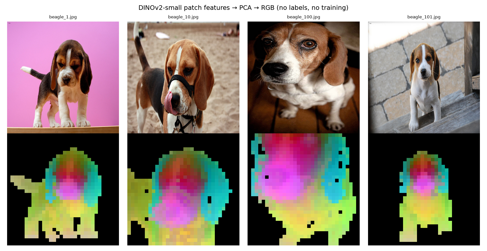
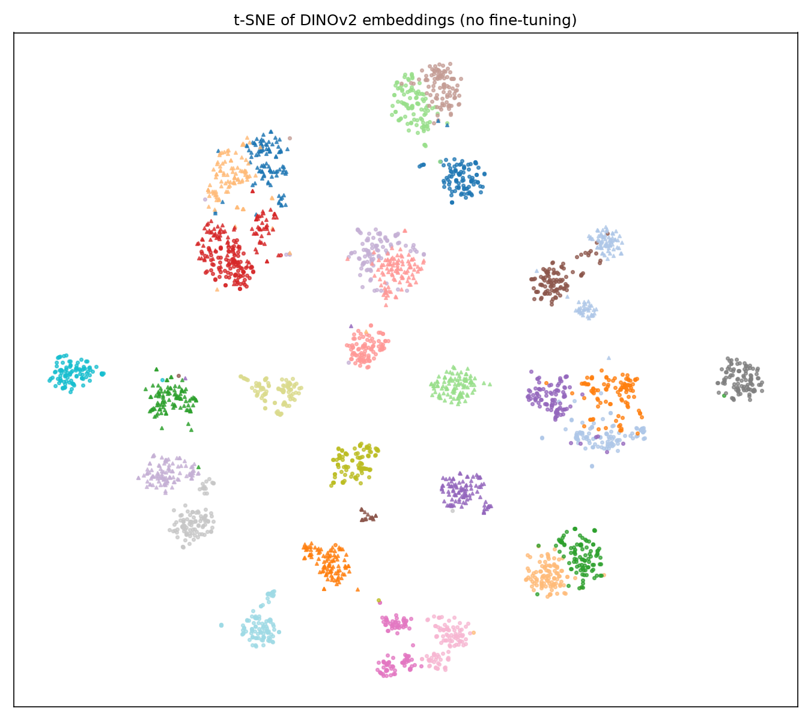
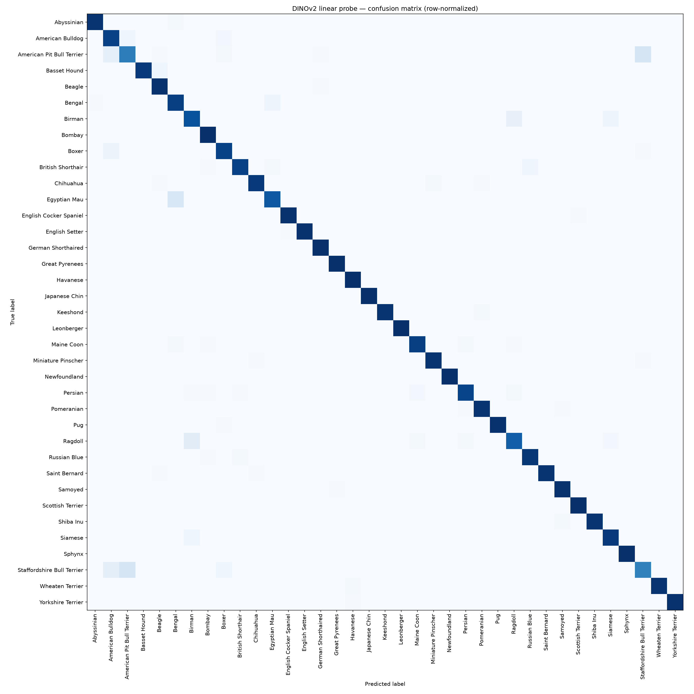
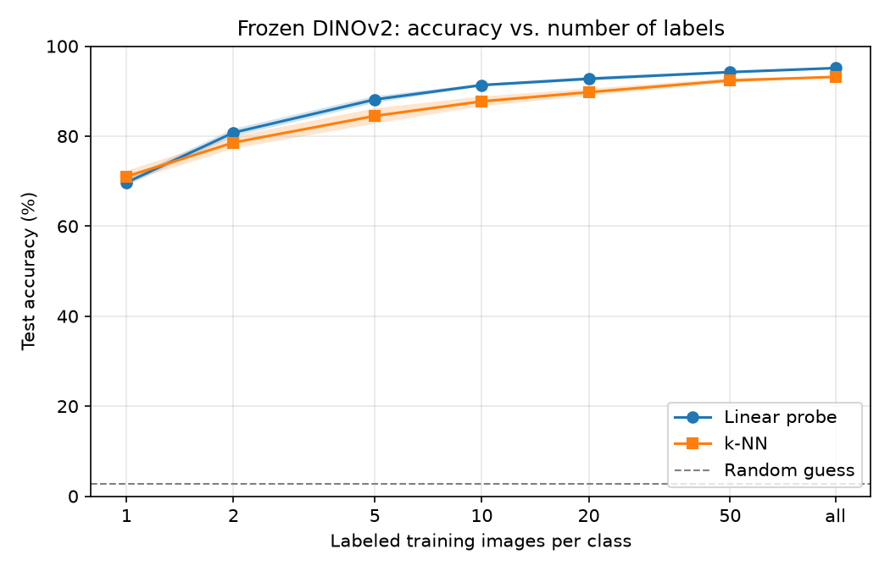
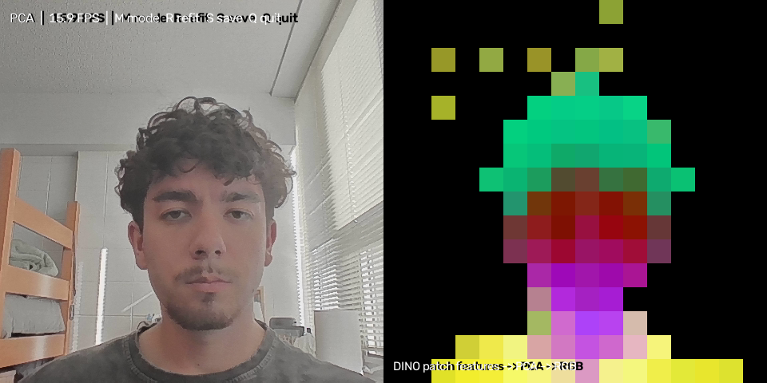

# DINO-Vision: Image classification and "what the model sees" with frozen DINOv2

Meta's **DINOv2** is a Vision Transformer trained with **self-supervised learning**: it learned from ~142M images without a single human label. This project shows how far those features go on their own:

- **Classification with almost no training:** DINOv2 stays frozen; only a logistic-regression layer is trained on top. Evaluated on the 37-breed Oxford-IIIT Pets dataset (works on CIFAR-10 or your own photos too).
- **Unsupervised part discovery:** PCA on DINOv2's per-patch features separates objects from background and colors matching parts (ears, eyes, legs) the same across different images, with no labels or training at all.

---

## Results

| Method (DINOv2 ViT-S/14, frozen) | Dataset | Accuracy | Macro-F1 |
| :--- | :--- | :---: | :---: |
| k-NN (k=10, cosine) | Oxford-IIIT Pets | 93.16% | 93.03% |
| Linear probe | Oxford-IIIT Pets | 95.09% | 95.00% |

*Numbers come from `results/metrics.json`.*

### Patch-feature PCA

Top: input images. Bottom: the first 3 principal components of the foreground patches, shown as RGB.



### Feature space and misclassifications

| t-SNE of embeddings | Confusion matrix |
| :---: | :---: |
|  |  |

---

## How many labels does DINO need?



With only 5 labeled images per breed, the linear probe already reaches **88.1% accuracy**, compared with 95.1% using the full training set.

---

## Live webcam demo (OpenCV)

`webcam_demo.py` uses OpenCV to capture webcam frames, runs DINOv2 on each one, and draws either live breed predictions or the patch-PCA view in real time.



---

## How it works

```text
image ──► DINOv2 (frozen) ──► 384-dim CLS embedding ──► logistic regression ──► class
               │
               └──► one feature per 14×14 patch ──► PCA ──► RGB "what the model sees" map
```

| File | What it does |
| :--- | :--- |
| `dino_utils.py` | Loads DINOv2 from `torch.hub`, preprocessing, feature extraction |
| `embed.py` | Runs every image through the frozen model and saves one embedding per image |
| `train_probe.py` | Trains k-NN and a linear probe; saves metrics, confusion matrix, t-SNE |
| `patch_pca.py` | Two-stage PCA on patch tokens: component 1 = foreground mask, then 3 components on foreground = RGB |
| `few_shot.py` | Evaluates classification accuracy vs. number of labeled samples |
| `webcam_demo.py` | Real-time camera classification and PCA view via OpenCV |
| `predict.py` | Classifies new images with the trained probe |

Because only a linear layer is trained, the full pipeline takes minutes.

---

## Run it

```bash
git clone https://github.com/mdjur1/dino-vision.git
cd dino-vision
pip install -r requirements.txt

python embed.py --dataset pets          # downloads Pets + DINOv2 weights (~800 MB) on first run
python train_probe.py
python patch_pca.py data/oxford-iiit-pet/images/beagle_1*.jpg --max-images 4
python predict.py data/oxford-iiit-pet/images/pug_10.jpg
python few_shot.py
python webcam_demo.py
```

Other options:

- `python embed.py --dataset cifar10 --max-train 5000` for CIFAR-10 (a subset, for speed on CPU)
- `python embed.py --dataset folder --data my_photos` with your own images in `my_photos/<class_name>/*.jpg`
- `--model base` or `--model large` for a bigger backbone (slower, more accurate)

No GPU? Use Google Colab (`Runtime → Change runtime type → T4 GPU`) and run the same commands with `!` in front.

---

## Next steps

- [ ] Compare against DINOv3 (Aug 2025) and a supervised ImageNet ResNet-50 baseline
- [ ] Train a small segmentation head on the patch tokens

---

## References

- Caron et al., *Emerging Properties in Self-Supervised Vision Transformers* (DINO), ICCV 2021
- Oquab et al., *DINOv2: Learning Robust Visual Features without Supervision*, 2023
- Siméoni et al., *DINOv3*, 2025
